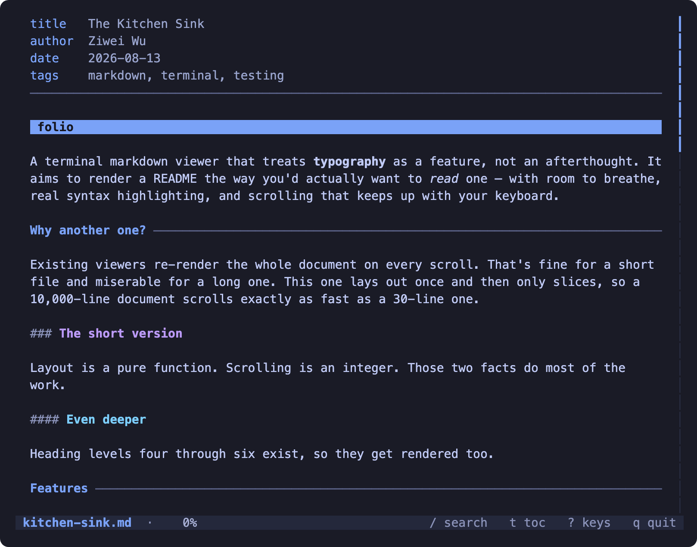
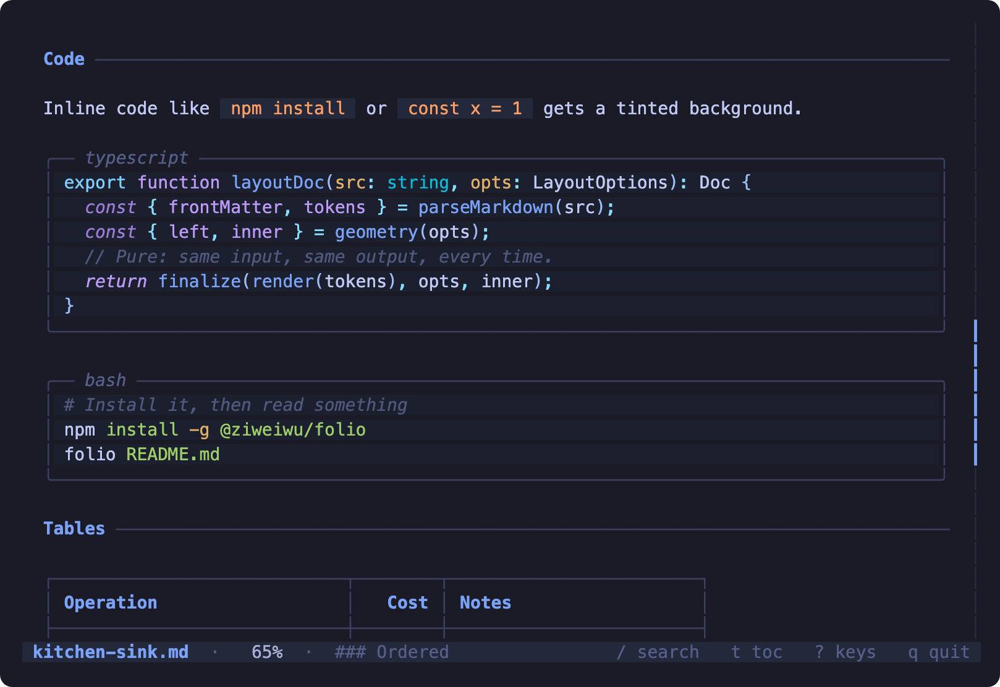
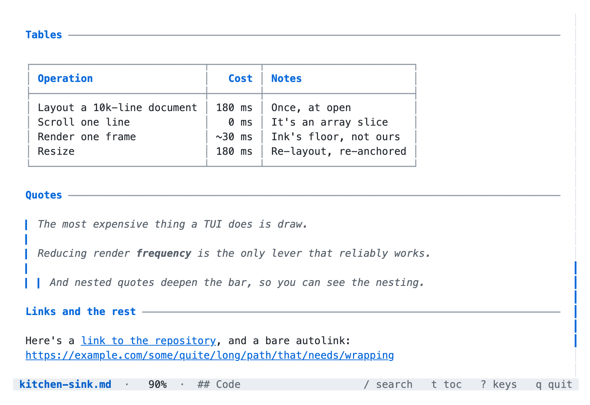

# Links

Links in a terminal pager are only useful if you can *go* somewhere. In folio,
`Tab` picks the next link and scrolls it into view, `⇧Tab` steps backwards,
`Enter` follows it, and `Backspace` goes back the way you came.

Try it now: press `Tab` a few times and watch the picked link move down this
page. Every relative link on it resolves to a file that exists, except one,
which is broken on purpose and clearly marked further down.

## Inline links

The ordinary form, `[text](target)`:

- [Back to the index](README.md) — a sibling file
- [The basics file](01-basics.md) — another sibling
- [The project README](../README.md) — one directory up
- [The full guide](../docs/GUIDE.md) — up and back down into `docs/`
- [Shiki](https://shiki.style) — external, shown rather than opened

An external link is deliberately *not* launched into a browser. A pager that
opens Chrome because you pressed Enter is a surprise, and terminals that
support OSC 8 already make the link clickable with the mouse.

### Extensionless and directory targets

A relative link does not need the `.md`. folio tries the obvious spellings in
order: the path itself, then `.md`, then `.markdown`, then `index.md` and
`README.md` inside it if it is a directory.

- [Without the extension](05-tables) — finds `05-tables.md`
- [A directory](.) — finds `README.md` in this folder
- [The repository root](..) — finds the project's own `README.md`

## Links with titles

A title in quotes after the target is the tooltip a browser would show. It has
nowhere to go in a terminal, so it is used as the link's text when there is no
text — and otherwise quietly ignored, which is better than printing it twice.

- [Unicode stress test](07-unicode.md "Every way a character can be wider than it looks")
- [Diagrams](06-diagrams.md 'Single quotes work too')
- [Front matter](08-frontmatter.md (parentheses also work))

## Reference links

Reference style keeps the URLs out of the prose, which makes the source much
easier to read when the same target appears several times. The definitions sit
at the bottom of this file.

The layout engine is described in [the guide][guide], the invariants it is
built against are in [INVARIANTS.md][inv], and the working agreement for
changing any of it is [AGENTS.md][agents]. The [tables example][tables] uses
all three ideas at once.

A [collapsed reference][] uses its own text as the label. And a [shortcut
reference] needs no brackets at all after it.

Reference definitions are case-insensitive, so [GUIDE][] and [guide][] are the
same target.

## Autolinks and bare URLs

An autolink is a URL in angle brackets, and it becomes its own text:
<https://github.com/ziweiwu/folio>. Email works the same way:
<hello@example.com>.

GFM also linkifies bare URLs, so https://www.npmjs.com/package/@ziweiwu/folio
is clickable without any markup at all. A long one wraps like any other text:
https://github.com/ziweiwu/folio/blob/main/src/md/layout.ts#L112-L140 — and
the target stays attached to the row whichever way the link mode is set, so
`Enter` works even when the terminal cannot draw a clickable link.

A URL inside `code spans is not a link`, so https://example.com written as
`https://example.com` stays literal.

## Anchors within this file

An anchor jumps to a heading in the document already open, using the same slug
GitHub generates: lowercase, punctuation dropped, spaces hyphenated.

- [Jump to Wikilinks](#wikilinks)
- [Jump to Images](#images)
- [Jump to The deliberately broken link](#the-deliberately-broken-link)
- [Back up to Inline links](#inline-links)

Anchors match loosely as a fallback, so a hand-written one that is close enough
still lands somewhere useful rather than doing nothing: [#anchors](#anchors)
finds the "Anchors within this file" heading above.

## Anchors into other files

Combine a path and a `#fragment` and you get both: folio opens the file and
scrolls to the heading.

- [Basics → Emphasis](01-basics.md#emphasis)
- [Basics → HTML entities](01-basics.md#html-entities)
- [Lists → Task lists](02-lists.md#task-lists)
- [Code → A language that does not exist](03-code.md#a-language-that-does-not-exist)
- [Tables → A very wide table](05-tables.md#a-very-wide-table)
- [Unicode → Emoji](07-unicode.md#emoji)

## Wikilinks

`[[Double brackets]]` are not part of any markdown standard, but they are how
Obsidian, Foam and most personal wikis link between notes — and those are
exactly the files people read in a terminal. folio turns them into ordinary
links, so everything downstream treats them the same way.

- Plain: [[05-tables]] resolves to `05-tables.md`
- Labelled: [[06-diagrams|the diagrams example]] shows the label, follows the
  target
- With a heading: [[07-unicode#Emoji]] opens the file and jumps to the section
- Labelled *and* anchored: [[02-lists#Task lists|the task list section]]

They work in the middle of a sentence too: the point of [[01-basics]] is that
the ordinary case has to read well before anything else matters.

## Link text that contains formatting

The text of a link is inline markdown like any other, so it can carry
emphasis, code, or both:

- [**A bold link**](01-basics.md)
- [*An italic one*](02-lists.md)
- [`A link that is code`](03-code.md)
- [A link with ***everything*** and `code` in it](05-tables.md)
- [~~A struck-through link~~](06-diagrams.md)
- [A link whose text is long enough that it will certainly wrap across two
  rows at any sensible text column, which is worth checking because the target
  has to stay attached to both of them](07-unicode.md)

## Images

An image cannot be drawn in a terminal without a protocol the terminal has to
support, so folio shows a placeholder and the alt text. That is honest, it
costs nothing, and the alt text is usually the part that carries the meaning
anyway.

The third one has no alt text at all, which is a real thing people write and
a real thing a renderer has to survive.

An image can be wrapped in a link, which is how a badge works:

## The deliberately broken link

The next link points at a file that does not exist, and is here on purpose.
Following it should say so plainly in the status bar and leave you exactly
where you were — not clear the document, not crash, not silently do nothing.

[This target does not exist](99-nowhere.md)

That is the only broken link in this whole tour; every other relative path on
every page resolves to a real file. The same handling covers the rest of the
ways a target can fail — a directory that is not there, a file you have no
permission to read, a path that escapes the project. Whether `stat` succeeds is
not the same question as whether the file can be read, so a refusal can arrive
after the viewer has already committed to the jump. It becomes a message in the
status bar, never a blank screen.

## Where to next

Back to the [index](README.md), or on to [Tables](05-tables.md).

[guide]: ../docs/GUIDE.md
[inv]: ../INVARIANTS.md
[agents]: ../AGENTS.md
[tables]: 05-tables.md
[collapsed reference]: 03-code.md
[shortcut reference]: 02-lists.md
