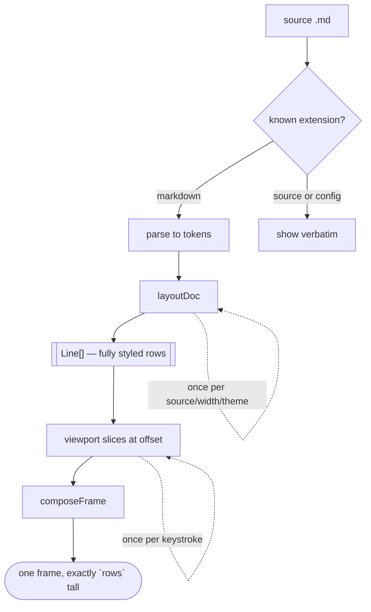
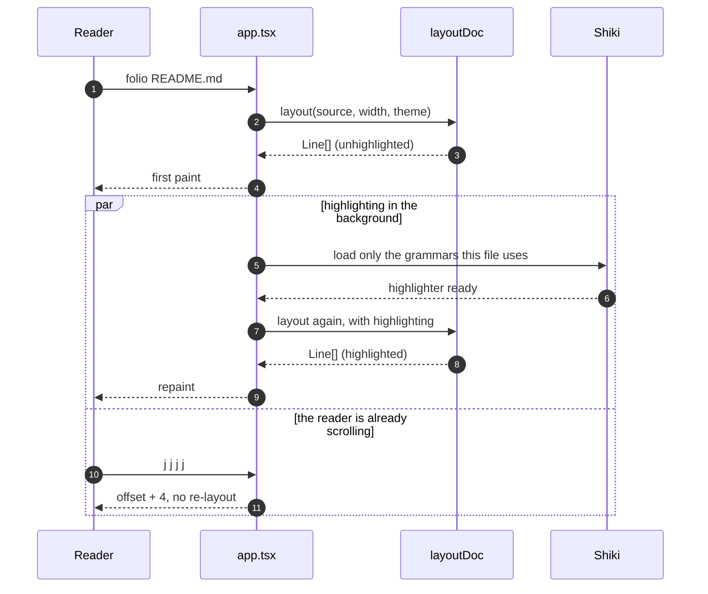
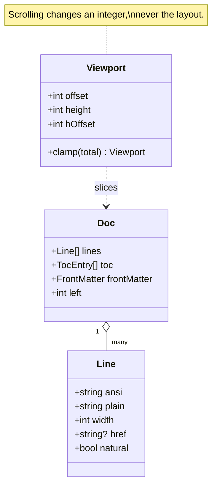

# Diagrams

folio does not render mermaid. It shows the fenced block, unhighlighted and
complete, exactly as written.

That is a deliberate choice rather than a missing feature. Rendering a mermaid
graph into character cells means a layout engine, a graph-drawing library and a
set of decisions about what to do when the diagram does not fit — which is a
lot of surface for something you can read as source, and the source is usually
legible. What folio owes you here is that the block survives verbatim, keeps
its indentation, and does not get mangled into a paragraph.

The other three kinds of diagram in this file — ASCII art, `tree` output and
box-drawing tables — *are* the finished picture, and those have to come through
character-for-character or they are worthless.

## Mermaid: a flowchart



## Mermaid: a sequence diagram



## Mermaid: a class diagram



## ASCII art: the whole design in one picture

This is the diagram from the project README, and it is the clearest statement
of the architecture there is:

```
source ──parse──▶ tokens ──layout──▶ Line[]     once, per
                                       │     (source, width, theme)
                            offset ────┴──▶ compose ──▶ frame
                                                        per scroll
```

Everything to the left of `Line[]` happens once. Everything to the right
happens per keystroke and costs about a tenth of a millisecond.

## ASCII art: what a frame is made of

```
┌──────────────────────────────────────────────────┐
│                                                  │ ← top margin
│   ## Tables                            ▓         │
│   ─────────────────────────────        ▓         │
│                                        ░         │
│   A table is the one construct         ░         │
│   where a viewer has to solve          ░ ← scrollbar
│   a layout problem.                    ░         │
│                                        ░         │
│ ‹ | Key | Moves        | Notes      |  ░ ›       │
│   | j k | one line     | coalesced  |  ░         │
│                                        ░         │
├──────────────────────────────────────────────────┤
│ 05-tables.md   Tables ▸ Alignment  34% ↔ q ?     │ ← status bar
└──────────────────────────────────────────────────┘
  ▲             ▲                    ▲   ▲
  file          section you are in   pos shifted sideways
```

The `‹` and `›` on the table row are not decoration. They mark an edge the row
runs past, and they are characters rather than colours precisely so that they
survive `--plain`. A mark that exists only in colour is not a mark.

## ASCII art: a box-and-arrow sketch

```
        +----------------+          +----------------+
        |   your file    |          |   your file    |
        |   (on disk)    |          |  (in an editor)|
        +--------+-------+          +--------+-------+
                 |                           |
                 | read once                 | --watch
                 v                           v
        +--------------------------------------------+
        |                sanitize()                  |
        |  control bytes -> caret notation (^[, ^G)  |
        +----------------------+---------------------+
                               |
                               v
                    +----------------------+
                    |  known extension?    |
                    +----+------------+----+
                         |            |
              markdown   |            |  .py .json .org .log
                         v            v
                   +-----------+  +-----------+
                   |  marked   |  | verbatim  |
                   +-----+-----+  +-----+-----+
                         |              |
                         +------+-------+
                                v
                          +-----------+
                          | layoutDoc |
                          +-----------+
```

## `tree` output

The output of `tree` is a diagram that happens to be text, and it is probably
the single most common one in a README. Every one of those box-drawing
characters is one cell wide, and the indentation is the meaning:

```
folio
├── src
│   ├── app.tsx
│   ├── cli.tsx
│   ├── core
│   │   ├── ansi.ts
│   │   ├── coalesce.ts
│   │   ├── links.ts
│   │   ├── position.ts
│   │   ├── positions.ts
│   │   ├── sanitize.ts
│   │   ├── search.ts
│   │   ├── width.ts
│   │   └── wrap.ts
│   ├── md
│   │   ├── code.ts
│   │   ├── highlight.ts
│   │   ├── inline.ts
│   │   ├── layout.ts       ← the one pure function everything rests on
│   │   ├── parse.ts
│   │   ├── tables.ts
│   │   └── text.ts
│   └── ui
│       ├── chrome.ts
│       ├── overlay.ts
│       ├── panes.ts
│       ├── screen.ts
│       └── theme.ts
├── examples
│   ├── README.md
│   ├── 01-basics.md
│   └── ...
├── scripts
│   ├── frame.ts
│   ├── frames.ts
│   └── smoke.sh
├── AGENTS.md
├── INVARIANTS.md
└── README.md

7 directories, 28 files
```

## Box-drawing tables

Some tools draw their own tables rather than emitting markdown — `psql`,
`sqlite3`, `docker`, half the Rust CLI ecosystem. Pasted into a fenced block,
those have to come through with their borders intact, which means every glyph
in them has to measure exactly one cell:

```
┌────────────────────────────┬──────────┬────────────────────────┐
│ Invariant                  │ Number   │ Where it is enforced   │
├────────────────────────────┼──────────┼────────────────────────┤
│ Rows fit the terminal      │ I-1      │ md/layout.ts           │
│ Cells, never String.length │ I-2      │ core/width.ts          │
│ Layout is pure             │ I-3      │ md/layout.ts           │
│ Scrolling never re-lays    │ I-4      │ ui/chrome.ts           │
│ Offset stays in range      │ I-5      │ core/position.ts       │
│ Resize keeps your place    │ I-6      │ core/position.ts       │
└────────────────────────────┴──────────┴────────────────────────┘
```

A lighter style, which some tools prefer:

```
╭──────────────┬───────────┬──────────────────────────────╮
│ Command      │ Exit code │ Meaning                      │
├──────────────┼───────────┼──────────────────────────────┤
│ folio ok.md  │         0 │ read it, showed it, done     │
│ folio no.md  │         1 │ could not read the document  │
│ folio --wat  │         2 │ bad usage                    │
│ folio x │ head -1        │ 0 — the reader stopped early │
╰──────────────┴───────────┴──────────────────────────────╯
```

And the double-ruled style, which is rarer but still turns up:

```
╔═══════════════════╦═══════════╦═══════════╗
║ Document          ║ Rows      ║ Layout    ║
╠═══════════════════╬═══════════╬═══════════╣
║ a short README    ║        30 ║      2 ms ║
║ this examples set ║       ~90 ║      6 ms ║
║ the large fixture ║     6,246 ║    135 ms ║
╚═══════════════════╩═══════════╩═══════════╝
```

## The point of all this

Pipe this file through `cat` and compare:

```sh
folio examples/06-diagrams.md | cat
```

Every diagram above should come out with its characters in the same order as
the source, with no escape codes and no trailing whitespace. Give the terminal
enough columns — every one of these fits in 80 — and each block is identical to
what is in the file.

Printed output is folded to fit rather than scrolled, because a pipe has no
viewport to pan. A diagram wider than the terminal therefore comes back
wrapped, which is ugly but lossless. In the pager it is neither: the block is
laid out at its natural width and `l` and `h` move over it, with `‹` and `›`
marking whichever edge continues. That is the whole promise of this page — a
diagram is content, and content survives.

## Where to next

Back to the [index](README.md), or on to [Unicode](07-unicode.md).
